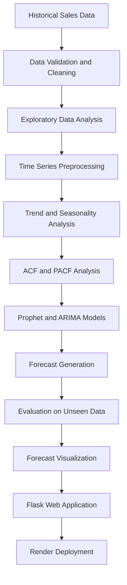
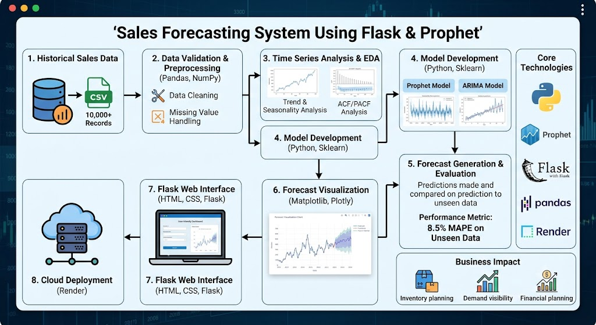

# 🚀 Sales Forecasting System Using Flask & Prophet

An end-to-end **time series forecasting application** that predicts future sales using historical business data, Prophet, ARIMA, and time series analysis. Built with Python and Flask, the application provides an interactive interface for exploring sales trends and generating forecasts to support data-driven business decisions.

<p align="center">
  <a href="https://sales-forecasting-system-using-flask-and-8qbi.onrender.com/">
    
  </a>
  <a href="https://github.com/TusharK93/Sales-Forecasting-System-using-Flask-and-Prophet---Time-Series-Project">
    
  </a>
</p>

<p align="center">
  
  
  
  
</p>

---

## 📌 Table of Contents

- [Project Overview](#-project-overview)
- [Business Problem](#-business-problem)
- [Solution](#-solution)
- [Key Features](#-key-features)
- [Model Performance](#-model-performance)
- [Technology Stack](#️-technology-stack)
- [Project Workflow](#-project-workflow)
- [System Architecture](#️-system-architecture)
- [Getting Started](#-getting-started)
- [Running the Application](#-running-the-application)
- [Business Impact](#-business-impact)
- [Future Improvements](#-future-improvements)
- [Skills Demonstrated](#-skills-demonstrated)
- [Live Demo](#-live-demo)
- [Author](#-author)

---

## 📌 Project Overview

**Sales Forecasting System Using Flask & Prophet** is an end-to-end time series forecasting project designed to estimate future sales based on historical business data.

The project works with **10,000+ sales records** and applies time series analysis, including **Facebook Prophet and ARIMA**, to identify patterns in historical sales and generate future demand predictions.

A Flask-based web application makes the forecasting workflow accessible through a user-friendly interface, allowing users to explore sales trends and view forecast results.

The project demonstrates the practical application of time series modeling, model evaluation, data analysis, visualization, and web application deployment.

## 🎯 Business Problem

Businesses need reliable demand estimates to make informed decisions about inventory, staffing, purchasing, and financial planning. However, future sales can be difficult to predict because historical data may contain trends, seasonal patterns, and fluctuations.

Poor forecasts can contribute to:

- Overstocking and excess inventory costs.
- Stock-outs and missed sales opportunities.
- Inefficient workforce and production planning.
- Uncertainty in budgeting and revenue projections.
- Difficulty aligning supply with customer demand.

### Project Objective

Develop a forecasting application that learns from historical sales data and generates useful predictions to support operational and strategic business decisions.

## 💡 Solution

The system combines time series analysis with forecasting models to transform historical sales data into future sales estimates.

The solution includes:

1. Preparing and validating historical sales data.
2. Analyzing sales trends and temporal patterns.
3. Exploring autocorrelation using ACF and PACF.
4. Applying Prophet and ARIMA forecasting approaches.
5. Evaluating predictions on unseen data.
6. Presenting forecast results through a Flask web application.
7. Deploying the application on Render for online access.

## ⚙️ Key Features

- **End-to-End Forecasting:** A complete workflow from historical data analysis to forecast generation.
- **10,000+ Sales Records:** Uses a substantial historical sales dataset for forecasting experiments.
- **Prophet Forecasting:** Models trends and recurring seasonal patterns.
- **ARIMA Analysis:** Supports statistical time series forecasting and model comparison.
- **ACF/PACF Analysis:** Helps investigate temporal dependence and inform ARIMA model selection.
- **Forecast Visualization:** Makes historical patterns and predicted values easier to interpret.
- **Model Evaluation:** Measures predictive performance on unseen data using MAPE.
- **Flask Web Interface:** Makes the forecasting functionality accessible through a web application.
- **Cloud Deployment:** Provides a live demonstration hosted on Render.
- **Modular Workflow:** Separates data analysis, forecasting, and application functionality for easier maintenance.

## 📊 Model Performance

The following results are based on the reported project evaluation.

| Metric | Result |
|---|---:|
| Historical sales records | 10,000+ |
| MAPE on unseen data | **8.5%** |
| Forecasting approaches | Prophet and ARIMA |
| Web framework | Flask |
| Deployment platform | Render |

### Mean Absolute Percentage Error (MAPE)

MAPE measures the average absolute percentage difference between actual and predicted values.

\[
\operatorname{MAPE} =
\frac{100}{n}
\sum_{t=1}^{n}
\left|
\frac{y_t-\hat{y}_t}{y_t}
\right|
\]

Where:

- \(y_t\) represents the actual sales value.
- \(\hat{y}_t\) represents the forecasted sales value.
- \(n\) represents the number of evaluated observations.

**Reported result: 8.5% MAPE on unseen data.**

This indicates an average absolute percentage error of 8.5% under the evaluation setup used for the project. MAPE can behave poorly when actual sales are zero or close to zero, so its suitability depends on the dataset.

*Note: The result is a reported project metric, not an independently verified benchmark. Forecast accuracy may vary with the evaluation period, data distribution, and forecasting horizon.*

## 🛠️ Technology Stack

| Category | Technologies |
|---|---|
| Programming language | Python |
| Forecasting | Facebook Prophet, ARIMA |
| Data manipulation | Pandas, NumPy |
| Time series analysis | ACF, PACF, trend and seasonality analysis |
| Visualization | Matplotlib, Plotly |
| Machine learning utilities | Scikit-learn |
| Web development | Flask, HTML, CSS |
| Deployment | Render |
| Version control | Git, GitHub |

## 🔄 Project Workflow



### Workflow Explanation

**1. Data Collection and Validation**

Load historical sales data and validate the required date and sales-value fields.

**2. Data Cleaning and Preprocessing**

Prepare the dataset for time series analysis, handle missing or invalid values as appropriate, and ensure that dates and sales values use the expected formats.

**3. Exploratory Data Analysis (EDA)**

Explore historical sales patterns, fluctuations, trends, and potential seasonality.

**4. Time Series Analysis**

Use ACF and PACF plots to investigate temporal dependencies and help inform ARIMA modeling decisions.

**5. Model Development**

Apply Prophet and ARIMA forecasting approaches to estimate future sales based on historical observations.

**6. Model Evaluation**

Evaluate predictions on unseen observations using MAPE to understand forecasting error.

**7. Visualization**

Present forecast results and historical patterns in a form that supports business interpretation.

**8. Deployment**

Serve the forecasting application through Flask and make it available online using Render.

## 🏗️ System Architecture

The application follows a straightforward data-to-prediction workflow:

- **Data layer:** Historical sales observations.
- **Analysis layer:** Data preparation, exploratory analysis, and time series diagnostics.
- **Forecasting layer:** Prophet and ARIMA models.
- **Evaluation layer:** Forecast comparison and error measurement.
- **Presentation layer:** Flask web interface and visualized results.
- **Deployment layer:** Render-hosted application.

This separation helps make the forecasting workflow easier to understand, test, and extend.

## 🚀 Getting Started

Follow these steps to run the project locally.

### Prerequisites

- Python 3.x compatible with the project's dependencies.
- Git.
- Pip.
- The project dataset and any required configuration files.

### 1. Clone the Repository

```bash
git clone https://github.com/TusharK93/Sales-Forecasting-System-using-Flask-and-Prophet---Time-Series-Project.git
```

### 2. Navigate to the Project Directory

```bash
cd Sales-Forecasting-System-using-Flask-and-Prophet---Time-Series-Project
```

### 3. Create a Virtual Environment

```bash
python -m venv venv
```

Activate it:

**Windows**

```bash
venv\Scripts\activate
```

**macOS / Linux**

```bash
source venv/bin/activate
```

### 4. Install Dependencies

If the repository includes a `requirements.txt` file:

```bash
pip install -r requirements.txt
```

If dependency installation fails, check the project's Python version requirements and the installation instructions for Prophet.

### 5. Configure the Dataset

Place the required historical sales dataset in the location expected by the project. Update the data path or configuration if necessary.

The dataset should contain a date or timestamp column and a sales value column. The exact column names depend on the implementation.

## ▶️ Running the Application

Run the Flask entry point specified by the repository. If the application entry point is `app.py`, use:

```bash
python app.py
```

Open the local URL printed in the terminal, commonly:

```text
http://127.0.0.1:5000/
```

**Note:** The exact entry point, route, dataset path, and local port should match the files included in the repository.

## 💼 Business Impact

A sales forecasting system can help businesses make better-informed operational decisions by providing estimates of future demand.

Potential applications include:

- **Inventory planning:** Estimate upcoming demand to support stock replenishment.
- **Stock-out reduction:** Identify periods when demand may exceed available inventory.
- **Resource allocation:** Improve planning for staffing, procurement, and production.
- **Financial planning:** Support revenue projections and budgeting.
- **Demand visibility:** Help decision-makers understand trends and seasonal patterns.

The reported 8.5% MAPE demonstrates the model's performance on the project's unseen evaluation data. Actual business benefits depend on how forecasts are integrated into inventory and operational decisions.

## 🔮 Future Improvements

Potential enhancements include:

- Add rolling-origin or walk-forward cross-validation for time series evaluation.
- Compare Prophet and ARIMA systematically against seasonal-naive baselines.
- Add prediction intervals to communicate forecast uncertainty.
- Support configurable forecast horizons and date ranges.
- Incorporate holidays, promotions, pricing, and other external regressors where suitable.
- Add forecast-versus-actual dashboards and model performance monitoring.
- Introduce automated data validation and scheduled model retraining.
- Add unit tests, API tests, and continuous integration.
- Containerize the application with Docker for reproducible deployment.
- Improve input validation, accessibility, and user experience.

## 🎓 Skills Demonstrated

- Time series forecasting and statistical modeling.
- Prophet and ARIMA.
- Exploratory data analysis.
- ACF and PACF interpretation.
- Data cleaning and preprocessing.
- Forecast evaluation using MAPE.
- Data visualization and business analytics.
- Python application development.
- Flask web development.
- Deployment and version control with Git and GitHub.

## 🌐 Live Demo

Try the deployed application:

**[Open Sales Forecasting System](https://sales-forecasting-system-using-flask-and-8qbi.onrender.com/)**

Source code:

**[View the GitHub Repository](https://github.com/TusharK93/Sales-Forecasting-System-using-Flask-and-Prophet---Time-Series-Project)**

*Note: Availability may depend on the hosting service. Free-tier applications can take time to start after periods of inactivity.*

## 👨‍💻 Author

**Tushar K**

GitHub: [TusharK93](https://github.com/TusharK93)

---

⭐ If you find this project useful, consider giving the repository a star.

<p align="center">
  
</p>


